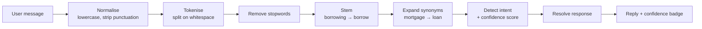

<div align="center">

# 🏦 Smart Banking Assistant

**A rule-based AI chatbot for banking queries, built from scratch with no external AI APIs.**


</div>

---

## Table of Contents

- [About](#about)
- [Features](#features)
- [Tech Stack](#tech-stack)
- [How It Works](#how-it-works)
- [Getting Started](#getting-started)
- [Usage Examples](#usage-examples)
- [Project Structure](#project-structure)
- [Database Schema](#database-schema)
- [AI Concepts Demonstrated](#ai-concepts-demonstrated)
- [Troubleshooting](#troubleshooting)
- [Limitations](#limitations)
- [Future Improvements](#future-improvements)
- [Author](#author)
- [References](#references)

---

## About

**Smart Banking Assistant** is a conversational chatbot for a fictional institution, **Smart Bank**. It understands natural-language questions about loans, credit cards, account management, fund transfers, balances and interest rates, and replies with context-appropriate answers.

Unlike most chatbots today, it uses **no cloud AI services or third-party NLP libraries**. The whole language-understanding stack (text normalisation, tokenisation, stopword removal, stemming, synonym expansion and intent detection) is implemented from first principles in TypeScript and runs entirely on your machine.

The goal is to show how conversational AI works under the hood.

> [!NOTE]
> This is a demonstration project. It does **not** connect to any real banking system, process real transactions, or store personal data. All banking products, rates and figures are fictional.

## Features

- 🧠 **Custom NLP pipeline**: normalise → tokenise → remove stopwords → stem, written from scratch
- 🎯 **Intent detection**: 18 intent categories plus an `UNKNOWN` fallback, with synonym expansion
- 📊 **Confidence badges**: every reply shows High / Medium / Low confidence so users can judge reliability
- 💬 **Follow-up handling**: "Tell me more" continues from the previously resolved topic
- 🎓 **Teach Mode (self-learning)**: when the bot doesn't know an answer, you can teach it, and it remembers (stored in SQLite)
- 🗄️ **Database-driven answers**: loan products rendered as live tables from the `loan_types` table
- 🎲 **Varied responses**: random pick from a response pool per intent, so it doesn't sound robotic
- 😊 **Basic emotional awareness**: recognises frustration, gratitude and small talk
- 🗂️ **Multiple conversations**: sidebar with new / switch / delete chat threads
- ⌨️ **Polished chat UI**: auto-resizing input, loading skeletons, `Enter` to send, `Shift + Enter` for a new line
- 🔒 **Fully local**: no API keys, no network calls, no sign-up

## Tech Stack

| Layer | Technology |
|---|---|
| Framework | [Next.js](https://nextjs.org/) (App Router, API routes) |
| UI | [React 18](https://react.dev/), [Tailwind CSS v4](https://tailwindcss.com/) |
| Language | [TypeScript 5](https://www.typescriptlang.org/) |
| Database | [SQLite](https://www.sqlite.org/) via [better-sqlite3](https://github.com/WiseLibs/better-sqlite3) |
| NLP / AI | Custom rule-based engine (`lib/nlp.ts`, `lib/intent.ts`) |

**Why these choices?** Next.js gives a full-stack setup with no separate backend; TypeScript adds type safety; SQLite needs zero configuration; and a rule-based engine is transparent, predictable and needs no training data.

## How It Works

Every message flows through the same pipeline:



### Intent detection

Intent rules are evaluated in a deliberate order, **specific intents before generic ones** (e.g. `HOME_LOAN` before `LOAN`), and the number of matched keywords determines confidence:

| Badge | Meaning | Trigger |
|---|---|---|
| ● High confidence | System is certain | 3 or more keywords matched |
| ◑ Medium confidence | System is fairly sure | 1 or 2 keywords matched |
| ○ Low confidence | System is uncertain | Fallback / no match |

**Supported intents:** `GREETING`, `LOAN`, `LOAN_TYPES`, `PERSONAL_LOAN`, `HOME_LOAN`, `VEHICLE_LOAN`, `BUSINESS_LOAN`, `EDUCATION_LOAN`, `CARD`, `BALANCE`, `ACCOUNT`, `TRANSFER`, `INTEREST`, `IDENTITY`, `PERSONALITY`, `FOLLOWUP`, `THANKS`, `ANGRY` (+ `UNKNOWN` as the fallback).

### Response resolution order

The API route (`/api/chat`) resolves each message through a prioritised chain, so taught knowledge always wins:

1. **Taught answer being saved?** Store it in the `learned` table and confirm.
2. **Learned answer exists?** Return it immediately (checked before intent detection).
3. **Detect intent** and confidence.
4. **IDENTITY / PERSONALITY**: answer directly.
5. **FOLLOWUP**: return a detailed answer for the last resolved topic (`lastIntent`).
6. **Specific loan intent**: query `loan_types` and format the details.
7. **LOAN_TYPES**: query all loans and return a table.
8. **FAQ match**: look up the `faq` table.
9. **Intent response pool**: pick a random variant for the intent.
10. **UNKNOWN**: reply that it doesn't know and trigger **Teach Mode**.

### Teach Mode

1. You ask something the bot doesn't recognise (e.g. *"What is your branch opening time?"*).
2. The bot replies that it's not familiar and shows a **Teach Mode** banner.
3. You type the correct answer and click **Teach** (or **Skip**).
4. The pair is upserted into the `learned` table, with a unique constraint on the question so a better answer can overwrite an old one.
5. Ask the same question again and the bot returns your answer.

## Getting Started

### Prerequisites

| Requirement | Version |
|---|---|
| Node.js | 20.x LTS recommended |
| npm | 9+ (bundled with Node.js) |
| Browser | Chrome 90+, Firefox 88+, Safari 14+ or Edge 90+ |
| OS | Windows 10/11, macOS 10.15+, or Linux (Ubuntu 20.04+) |

Verify your setup:

```bash
node --version
npm --version
```

### Installation

```bash
# 1. Clone the repository
git clone <repository-url>
cd ai-banking-chatbot

# 2. Install dependencies
npm install
```

### Run in development

```bash
npm run dev
```

Open **<http://localhost:3000>**. You'll be redirected to `/chat`.

On first run, the SQLite database (`chatbot.db`) is created and seeded automatically. No manual database setup is needed.

### Production build

```bash
npm run build
npm run start
```

### Optional configuration

No environment variables are required. To change the port:

```bash
# macOS / Linux
PORT=3001 npm run dev

# Windows (PowerShell)
$env:PORT=3001; npm run dev
```

### Quick smoke test

1. Type **"Hello"** → you get a greeting.
2. Type **"What loan types are available?"** → a table of 5 loans appears.
3. Type **"What is your branch address?"** → Teach Mode appears; teach an answer, then ask again.
4. Click **New Conversation** → a fresh chat starts.

## Usage Examples

| You say | Detected intent | What happens |
|---|---|---|
| "I want to know about loans" | `LOAN` | General loan overview (medium confidence) |
| "What loan types are available?" | `LOAN_TYPES` | Table of all loans from the database |
| "Tell me about home loan" | `HOME_LOAN` | Purpose, rate, max amount and duration |
| "What credit cards do you offer?" | `CARD` | Visa / Mastercard info |
| "How do I check my balance?" | `BALANCE` | Directs you to the account portal |
| "How can I send money?" | `TRANSFER` | Transfer methods and processing times |
| "Tell me more" | `FOLLOWUP` | Detailed info on the previous topic |
| "This is useless!" | `ANGRY` | Empathetic, apologetic reply |

### Sample loan products (fictional)

| Type | Purpose | Rate | Max Amount | Duration |
|---|---|---|---|---|
| Personal Loan | Personal expenses & emergencies | 12% p.a. | LKR 2,000,000 | Up to 5 years |
| Home Loan | Purchase or construct property | 9% p.a. | LKR 20,000,000 | Up to 25 years |
| Vehicle Loan | Cars, bikes or vans | 11% p.a. | LKR 5,000,000 | Up to 7 years |
| Business Loan | Start or expand a business | 14% p.a. | LKR 10,000,000 | Up to 10 years |
| Education Loan | Local and overseas education | 8% p.a. | LKR 3,000,000 | Up to 8 years |

## Project Structure

```text
ai-banking-chatbot/
├── app/
│   ├── page.tsx              # Root page, redirects to /chat
│   ├── chat/                 # Chat UI (React client component)
│   └── api/
│       └── chat/
│           └── route.ts      # POST /api/chat: response resolution, context, Teach Mode
├── lib/
│   ├── nlp.ts                # NLP pipeline: normalise, tokenise, stopwords, stem
│   ├── intent.ts             # Synonym expansion, intent rules, confidence scoring
│   └── db.ts                 # SQLite setup, schema, seeding
├── chatbot.db                # SQLite database (auto-created on first run)
├── package.json
└── tsconfig.json             # Includes the "@/*" path alias
```

## Database Schema

Three independent tables (no foreign keys, as each serves a separate lookup in the resolution chain):

| Table | Purpose |
|---|---|
| `faq` | Predefined question-answer pairs with intent labels |
| `loan_types` | Loan products: name, interest rate, max amount, duration, description |
| `learned` | User-taught answers, with a `UNIQUE` constraint on `question` |

## AI Concepts Demonstrated

**P.E.A.S. analysis**

| Component | Description |
|---|---|
| **Performance measure** | Intent-detection accuracy, response relevance and variety, successful teach interactions, response time, context handling |
| **Environment** | Web browser, chat interface, SQLite database, user text input, HTTP API |
| **Actuators** | Chat replies, loan table rendering, confidence badge, Teach Mode banner, loading animation, conversation sidebar |
| **Sensors** | User text input, teach-answer input, `lastIntent` context, database lookups, `teachAnswer` flag |

**Agent type:** Goal-based agent with learning-agent elements.
**Environment:** Partially observable · single agent · stochastic · sequential · static · discrete.

**AI traits and where they live**

| Trait | Implementation | Location |
|---|---|---|
| Natural language understanding | Normalise → tokenise → stopwords → stem | `lib/nlp.ts` |
| Intent classification | Keyword-based rule engine | `lib/intent.ts` |
| Synonym recognition | Synonym expansion map | `lib/intent.ts` |
| Confidence estimation | Three-tier scoring | `lib/intent.ts` |
| Context awareness | `lastIntent` tracking | `app/api/chat/route.ts` |
| Self-learning | Teach Mode + `learned` table | `app/api/chat/route.ts`, `lib/db.ts` |
| Response variation | Random response-pool selection | `app/api/chat/route.ts` |
| Emotional awareness | `ANGRY`, `THANKS`, `PERSONALITY` intents | `lib/intent.ts` |
| Knowledge representation | SQLite + response maps | `lib/db.ts`, `app/api/chat/route.ts` |

**Algorithm complexity** (n = characters, t = tokens, i = intents, k = keywords per intent, l = learned rows)

| Algorithm | Time | Space |
|---|---|---|
| Text normalisation | O(n) | O(n) |
| Tokenisation | O(n) | O(n) |
| Stopword removal | O(t) | O(t) |
| Stemming | O(t) | O(t) |
| Synonym expansion | O(t) | O(t) |
| Intent detection | O(i × k) | O(1) |
| Learned-answer lookup | O(l) | O(l) |
| Full response resolution | O(i × k + l) | O(l) |

<details>
<summary><b>Stemming rules</b></summary>

A simple suffix-stripping stemmer (not a full Porter stemmer):

- ends with `ing` and length > 5 → remove 3 characters (`borrowing` → `borrow`)
- ends with `tion` → remove 4 characters
- ends with `ed` and length > 4 → remove 2 characters
- ends with `s` and length > 3 → remove 1 character (`loans` → `loan`)
- otherwise unchanged

</details>

## Troubleshooting

<details>
<summary><b><code>node</code> is not recognized as a command</b></summary>

Node.js isn't installed or isn't on your `PATH`. Install the LTS version from [nodejs.org](https://nodejs.org/), then restart your terminal. On Windows, make sure "Add to PATH" is ticked during installation.
</details>

<details>
<summary><b><code>npm ERR! code ELIFECYCLE</code> or <code>SyntaxError: Unexpected token '??='</code></b></summary>

Your Node.js version is too old. Check it with `node --version`, upgrade to the current LTS, then reinstall:

```bash
rm -rf node_modules package-lock.json
npm install
```
</details>

<details>
<summary><b>Port 3000 is already in use</b></summary>

Use another port:

```bash
PORT=3001 npm run dev
```

Or free the port:

```bash
# macOS / Linux
lsof -ti:3000 | xargs kill -9

# Windows
netstat -ano | findstr :3000
taskkill /PID <PID> /F
```
</details>

<details>
<summary><b><code>Module not found: Can't resolve 'better-sqlite3'</code></b></summary>

Dependencies weren't installed correctly:

```bash
rm -rf node_modules package-lock.json
npm cache clean --force
npm install
```
</details>

<details>
<summary><b>Database file permission errors</b></summary>

The app needs write access to the project folder to create `chatbot.db`.

- **macOS / Linux:** `chmod -R 755 /path/to/project`
- **Windows:** right-click the folder → Properties → Security → give your user **Full Control**
</details>

<details>
<summary><b><code>Cannot find module '@/lib/db'</code></b></summary>

Check that `tsconfig.json` contains the path alias below, then restart the dev server:

```json
{
  "compilerOptions": {
    "paths": { "@/*": ["./*"] }
  }
}
```
</details>

**Start fresh:**

```bash
rm -rf node_modules .next chatbot.db package-lock.json   # chatbot.db is recreated on next run
npm install
```

> ⚠️ Deleting `chatbot.db` also removes everything you've taught the bot.

## Limitations

- **Rule-based NLP**: only understands queries within its predefined vocabulary; it won't handle complex or highly varied phrasing as well as a trained ML model.
- **Shared context**: `lastIntent` is a single server-side variable, so it is shared across all users and resets when the server restarts. Fine for a demo, not for multi-user use.
- **Basic stemmer**: simple suffix stripping, so some words stem imperfectly.
- **Fictional data**: no real banking integration.

## Future Improvements

- [ ] Replace rule-based NLP with a trained model (e.g. a fine-tuned BERT classifier)
- [ ] Per-session context stored in a database or Redis for proper multi-user support
- [ ] Voice input and output
- [ ] Automated tests for the NLP pipeline and intent rules

## Author

**Mahera Keshan**

## References

- Russell, S. and Norvig, P. (2021) *Artificial Intelligence: A Modern Approach*. 4th edn. Pearson.
- Jurafsky, D. and Martin, J.H. *Speech and Language Processing*. <https://web.stanford.edu/~jurafsky/slp3/>
- Porter, M.F. (1980) "An Algorithm for Suffix Stripping", *Program*, 14(3), pp. 130-137.
- Adamopoulou, E. and Moussiades, L. (2020) "An Overview of Chatbot Technology", *IFIP AICT*, 584, pp. 373-383.
- Weizenbaum, J. (1966) "ELIZA", *Communications of the ACM*, 9(1), pp. 36-45.
- Documentation: [Next.js](https://nextjs.org/docs) · [React](https://react.dev/) · [TypeScript](https://www.typescriptlang.org/docs/) · [better-sqlite3](https://github.com/WiseLibs/better-sqlite3) · [Tailwind CSS](https://tailwindcss.com/docs) · [SQLite](https://www.sqlite.org/docs.html)

---

<div align="center">
<sub>All banking data is fictional.</sub>
</div>
